# Auditoría UX/UI · TransitOne (EMPLIADOS Logistics Cloud)

**Análisis experto pantalla por pantalla para despachantes, finanzas y dirección: puntajes por dimensión, problemas críticos, hallazgos por módulo, sistema de diseño propuesto y roadmap priorizado.**

_Relevado el 3 de noviembre de 2026 con el usuario demo._

---

## Tabla de contenidos

- [Resumen ejecutivo](#resumen-ejecutivo)
- [Top 10 problemas críticos](#top-10-problemas-críticos)
- [Hallazgos transversales](#hallazgos-transversales)
  - [Navegación y arquitectura de información](#navegación-y-arquitectura-de-información)
  - [Tres dialectos de diseño](#tres-dialectos-de-diseño)
  - [Confianza en los datos](#confianza-en-los-datos)
  - [Microcopy, idioma y formatos](#microcopy-idioma-y-formatos)
  - [SOL embebido, accesibilidad y responsive](#sol-embebido-accesibilidad-y-responsive)
- [Análisis por módulo](#análisis-por-módulo)
  - [Operación](#operación)
  - [Agentes](#agentes)
  - [Finanzas](#finanzas)
  - [Marketing](#marketing)
- [Propuesta de sistema de diseño](#propuesta-de-sistema-de-diseño)
  - [Tokens](#tokens)
  - [Componentes a unificar](#componentes-a-unificar)
  - [Navegación propuesta](#navegación-propuesta)
  - [Diccionario de estados](#diccionario-de-estados)
- [Recomendaciones por perfil](#recomendaciones-por-perfil)
- [Roadmap priorizado](#roadmap-priorizado)

---

## Resumen ejecutivo

### Puntajes por dimensión (sobre 10)

| Dimensión | Puntaje |
|-----------|---------|
| Data viz | 6/10 |
| Jerarquía visual (por pantalla) | 6/10 |
| Microcopy e idioma | 5/10 |
| Consistencia / sistema de diseño | 4/10 |
| Arquitectura de información | 4/10 |
| Accesibilidad | 3/10 |
| Responsive | 3/10 |
| **Confianza en los datos** | **2/10** |

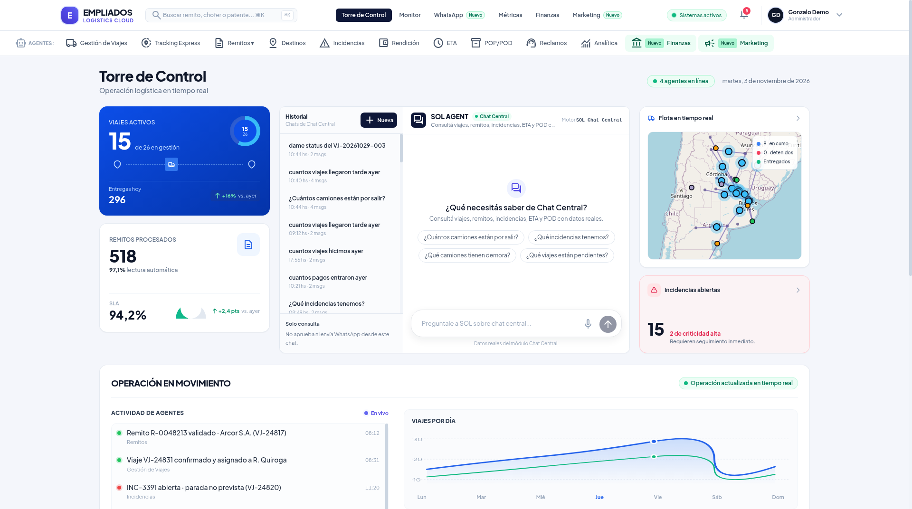
_Captura: Torre de Control principal_

**TransitOne se ve moderno pantalla por pantalla, pero como producto se siente como varias apps cosidas:** tres filas de navegación, tres dialectos visuales y números que se contradicen entre módulos. Para un software de operación y finanzas, la confianza en los datos es lo más grave: si el dueño ve 13 viajes en un lado y 17 en otro, deja de creerle al tablero entero.

### Los 3 grandes aciertos

✅ **Torre de Control con SOL embebido** y preguntas sugeridas ("¿Cuántos camiones están por salir?") es una gran idea de producto.

✅ **Monitor de Servicios** tiene un glosario de estados y alertas claras de servicio caído.

✅ **WhatsApp** tiene un layout de tres paneles (lista, chat, contexto del remito) muy bien pensado para el despachante.

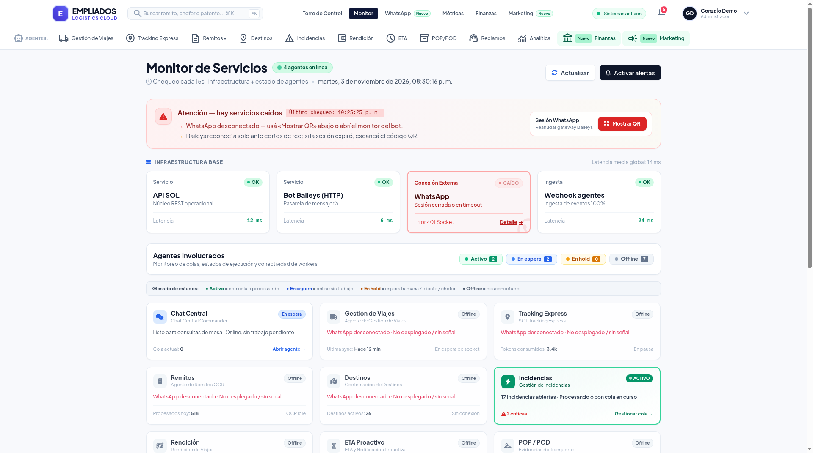
_Captura: Monitor con glosario de estados_

---

## Top 10 problemas críticos

| # | Problema | Evidencia | Perfil afectado | Severidad |
|---|----------|-----------|-----------------|-----------|
| **1** | **Números que se contradicen entre pantallas** | Métricas 13 viajes vs Viajes 17; Torre "15 de 26 en gestión"; Métricas "26 en gestión"; Finanzas cobrado $2.372.500 vs $3.032.500, cartera $467.400 vs $3.148.920 ($3.100.000 ARS en Antigüedad) | Todos | 🔴 Crítica |
| **2** | **Estado del sistema contradictorio** | Header "Sistemas activos" mientras Monitor dice "hay servicios caídos" (WhatsApp Error 401 Socket) y 7 agentes Offline; "4 agentes en línea" / "8 agentes en línea" | Despachante, dirección | 🔴 Crítica |
| **3** | **Eliminar no funciona en Marketing** | DELETE devuelve 400 en Promociones y catálogo del Planificador | Marketing | 🔴 Crítica |
| **4** | **Navegación en tres filas apiladas** | Nav principal + fila AGENTES (11 ítems) + subnav de Finanzas/Marketing; Finanzas y Marketing aparecen dos veces | Todos | 🔴 Alta |
| **5** | **Fechas incorrectas o fijas** | Desde 01/01/2026 se muestra "31 de dic de 2025"; Torre "12 de marzo de 2024"; "Hoy (26 Oct)" fijo en Finanzas | Todos | 🔴 Alta |
| **6** | **Acciones de dinero y envío sin jerarquía** | "Cobrar", "Conciliar", "Recordatorio Masivo WhatsApp", "Ubicar y enviar consulta por WhatsApp" con el mismo peso que acciones neutras | Finanzas, despachante | 🔴 Alta |
| **7** | **Artefactos de punto flotante y datos sin validar** | "1.7999999999999998 t carga general"; precio "abc" guardado; ítem de catálogo sin nombre "$1 (servicio)" | Despachante, marketing | 🔴 Alta |
| **8** | **Tipografía diminuta y abuso de MAYÚSCULAS** | Etiquetas de 9–11 px, títulos "GESTIÓN DE INCIDENCIAS", "CONCILIACIÓN DE COBROS Y PASARELAS" en caps | Todos | 🟠 Alta |
| **9** | **Sin responsive real** | Al 300% el header recorta "EM… LOG…" y la nav queda en "W"; sin menú móvil | Dirección (celular) | 🟠 Alta |
| **10** | **KPIs vacíos o engañosos** | "Tiempo de respuesta —", "0 eventos detectados hoy" junto a "15 abiertas", "0% entregados (0 de 17)" junto a 296 "Entregas hoy" | Dirección | 🟠 Alta |

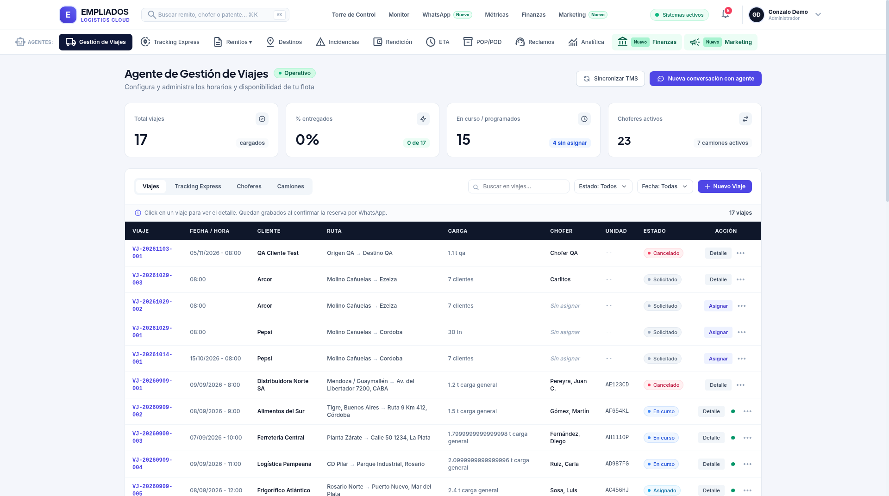
_Captura: Lista de viajes mostrando artefactos de float y problemas de formato_

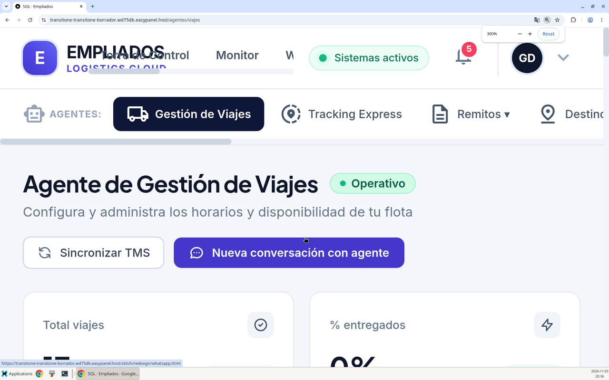
_Captura: Layout roto al 300% de zoom_

---

## Hallazgos transversales

### Navegación y arquitectura de información

- **Tres filas de navegación:** Torre de Control / Monitor / WhatsApp / Métricas / Finanzas / Marketing arriba, luego AGENTES: Gestión de Viajes, Tracking Express, Remitos▾, Destinos, Incidencias, Rendición, ETA, POP/POD, Reclamos, Analítica, Finanzas, Marketing, y en Finanzas/Marketing una tercera subnav.

- **Finanzas y Marketing están duplicados** en la fila 1 y la fila 2 con badge "Nuevo" en ambos: el usuario no sabe cuál es el "real".

- **Estado activo sobrecargado:** en Finanzas se pintan oscuros a la vez el ítem de la fila 1, el de la fila 2 y "Dashboard" en la fila 3. Tres píldoras negras compiten por atención.

- Hay **dos "Analítica"** (de Agentes y de Marketing) y **dos "Gestión de Viajes"** (el agente y la tabla dentro de Métricas).

- **"Nueva conversación con agente"** en Viajes navega a WhatsApp sin aviso: rompe el modelo mental.


_Captura: Botón que navega inesperadamente a otro módulo_

- Las pantallas parecen embebidas (iframe): flash al cargar y sin deep links estables por sección o por viaje.

### Tres dialectos de diseño

| Dialecto | Dónde | Rasgos |
|----------|-------|--------|
| **A · Claro aireado** | Torre, Métricas, Viajes, Marketing | Títulos en minúscula, cards blancas, primario violeta "+ Nuevo Viaje" |
| **B · Técnico mono** | Finanzas, Conciliación, Incidencias | Títulos en MAYÚSCULAS, cifras en monoespaciada, primario negro "+ Nuevo Cobro", "Conciliar" |
| **C · Panel oscuro** | Incidencias (mapa), Cleexs Score en Marketing | Bloques navy con texto claro dentro de páginas claras |

**Primarios observados:** violeta (Nuevo Viaje, Nueva conversación con agente), negro (Activar alertas, Nuevo Cobro, Conciliar), azul (Crear campaña, Proponer campaña), verde (Ubicar y enviar por WhatsApp, Generar y enviar enlace por WhatsApp, Confirmar y Cerrar Viaje), azul (+ Registrar nuevo cliente), rojo (Mostrar QR) y teal (Resolver y notificar cliente, solo en Reclamos).

Además "Pagar / Autorizar", que mueve dinero, va en el mismo negro que cualquier primario. **Seis colores para "acción principal" es caos:** el ojo no aprende dónde actuar.

### Confianza en los datos

- **Totales distintos** para el mismo concepto en distintas pantallas (ver Top 1).

- Un mismo viaje figura **"En curso" en un lado y "Cancelado" en otro**; patentes que no coinciden.

- **Conciliación:** pestaña "Todos (3)" pero "Total cobrado hoy $48.290.450 · 142 operaciones" y paginación 1, 2, 3 … 15 con 3 registros.

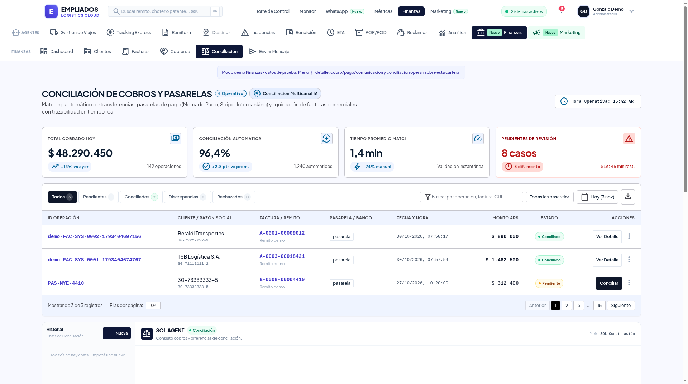
_Captura: Contadores inconsistentes en Conciliación_

- Gráficos con notas al pie que suenan a dato real ("Pico: 118", "Evolución semanal consolidada") sin fuente ni rango verificable.

- Banners "Modo demo Finanzas · datos de prueba" y "Envío de email deshabilitado" bien, pero mezclados con KPIs que se presentan como reales.

- **Analítica** admite con la nota _'La curva del dibujo no es la serie medida.'_ que el gráfico es ilustrativo, y su tooltip dice 1.120 viajes contra 'Total semana: 4 viajes'.

- **Enviar Mensaje** previsualiza PepsiCo Central por $1.240.000 cuando las facturas elegidas son de MYE Cargas y Cuyo Express.

- **Contadores que no suman:** Reclamos 'Resueltos 18' = Todos 18 con 8 abiertos; Remitos '0 hoy, +18% vs ayer'; Clientes 'Con saldo 18' vs 'Con saldo pendiente 0'; Facturas '1–6 de 82' vs 8.

- Placeholders "—" en KPIs (Tiempo de respuesta, Performance del conductor VIAJES / SLA / SCORE) sin explicar por qué no hay dato.

### Microcopy, idioma y formatos

- **Enums en inglés** filtrados a la UI: `NOT_STARTED`, `en_gestión`, `article`, `case_study`, `PUBLISHED`, `ready`, `running`, `APPROVED`, `DRAFT`, "Offline", "En hold", "Error 401 Socket".

- **Fechas mezcladas:** "2026-10-23" (ISO) en Finanzas, "15/10/2026 - 08:00", "30/10/2026, 07:58:17", "martes, 3 de noviembre de 2026, 08:30:16 p. m.".

- **Decimales y porcentajes inconsistentes:** "1,2 t" vs "1.799…", "$1.8M (58%)" vs "$ 2.372.500".

- **Fechas US mm/dd/yyyy** en Nuevo viaje y Promociones; un error de JS crudo visible en un chat.

- **Jerga técnica** para usuarios de negocio: "OCR Vision Engine v4.2 | Latencia: 248ms", "Motor de Cobranza v2.4", SPF/DKIM, GSC, "Bot Baileys (HTTP)", "Webhook agentes", "Incident AI Core v3.2", "Matching automático".

- **Badges "Nuevo" permanentes** en WhatsApp, Finanzas y Marketing pierden sentido.

### SOL embebido, accesibilidad y responsive

- **SOL Agent ocupa el centro** de Torre de Control y también aparece al pie de Conciliación: está en la mejor posición de la pantalla más importante, desplazando excepciones operativas.

- **Historial de SOL** muestra preguntas repetidas ("cuantos viajes llegaron tarde ayer" dos veces) sin agrupar.

- **Contraste bajo** en texto gris chico (subtítulos, "10:44hs · 2 msgs") y en el logo del login.

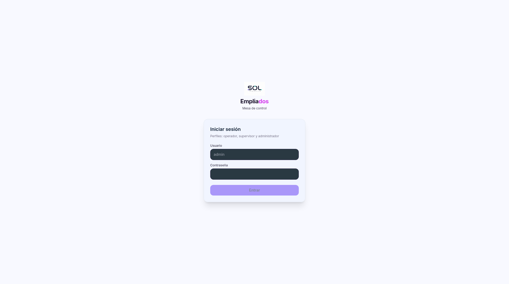
_Captura: Login con wordmark de bajo contraste_

- **Foco de teclado** poco visible en la nav; botones de ícono (•••, campana, ⋮) sin etiqueta evidente.

- **El estado depende solo del color** (puntos verde/rojo en Actividad, Glosario de estados).

- **Sin menú móvil** ni colapso de nav; tablas de 9 columnas sin estrategia para pantallas angostas.

---

## Análisis por módulo

### Operación

#### Login


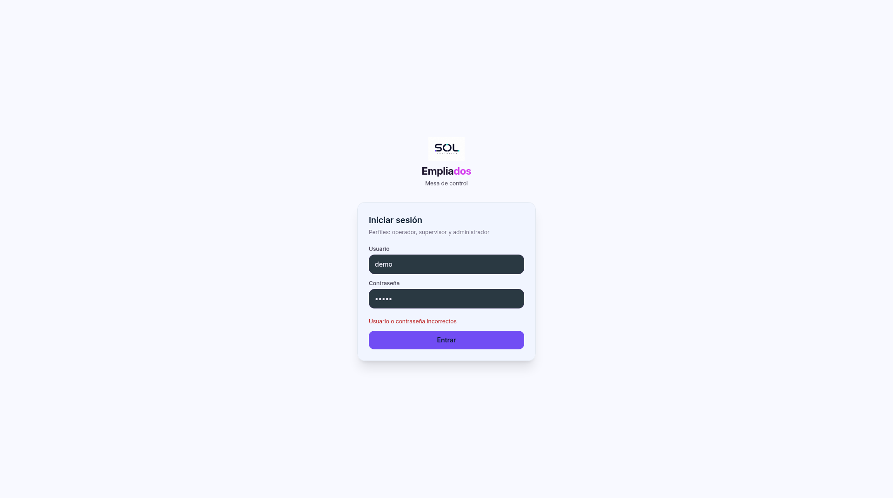

**Lo que funciona:**
- Simple, centrado, aclara perfiles (operador, supervisor y administrador)

**Problemas críticos:**
- Logo SOL casi invisible
- Dos marcas (SOL / Empliados) distintas a la del app (EMPLIADOS Logistics Cloud)
- Inputs navy oscuros sobre card clara
- Placeholder "admin"
- Sin mostrar contraseña ni "¿Olvidaste tu contraseña?"
- Texto de error de unos 9 px
- "Entrar" deshabilitado con bajo contraste

**Recomendación concreta:**
Una sola marca; inputs claros con borde; placeholder neutro ("Tu usuario"); ojo para mostrar contraseña y recuperación; error inline de 13 px o más con contraste AA.

#### Torre de Control


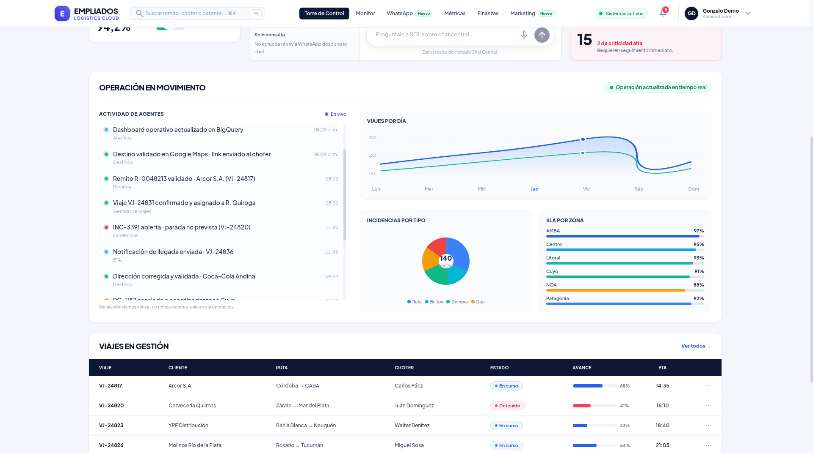
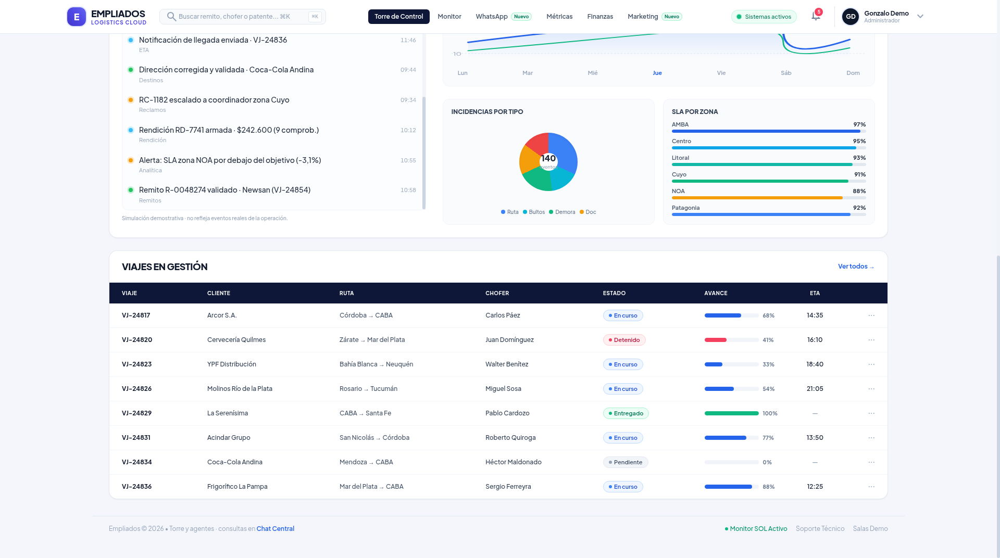

**Lo que funciona:**
- Hero de Viajes activos legible
- Mapa de flota con leyenda
- Card de Incidencias abiertas en rojo
- Preguntas sugeridas de SOL

**Problemas críticos:**
- El centro lo ocupa un chat, no las excepciones
- "Entregas hoy 296" contradice "0% entregados"
- "4 agentes en línea" vs Monitor
- Gráfico Viajes por día sin valores

**Recomendación concreta:**
Convertirla en torre por excepción: cola de alertas priorizada arriba (viajes demorados, sin asignar, incidencias críticas), SOL como panel lateral plegable.

#### Monitor de Servicios


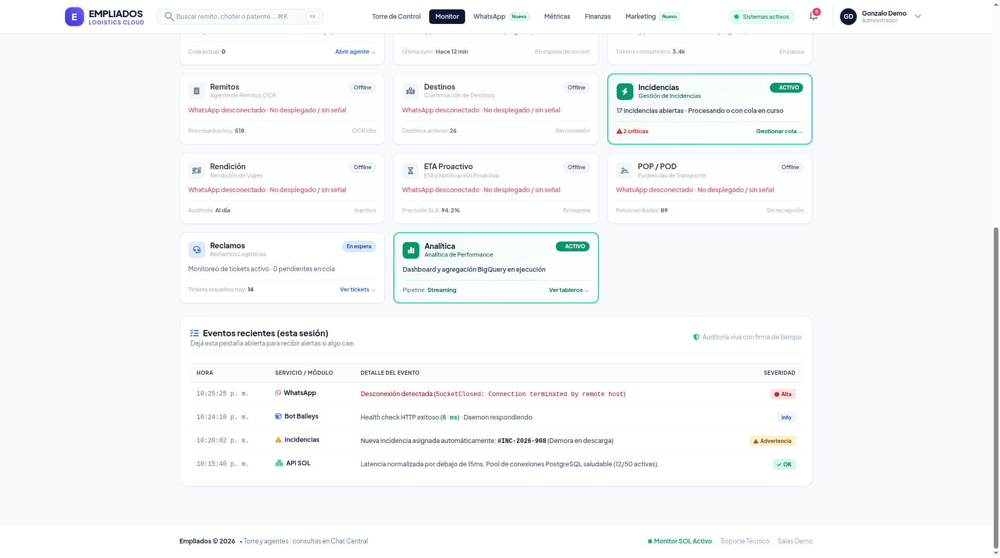

**Lo que funciona:**
- Banner de servicios caídos claro
- Glosario de estados
- Latencias por servicio

**Problemas críticos:**
- Header sigue diciendo "Sistemas activos"
- Timestamp "10:25:25 p. m." vs "08:30:16 p. m."
- Jerga (Baileys, Webhook)

**Recomendación concreta:**
El indicador global debe leer de Monitor ("1 servicio caído" en rojo); lenguaje de negocio con detalle técnico colapsable.

#### WhatsApp

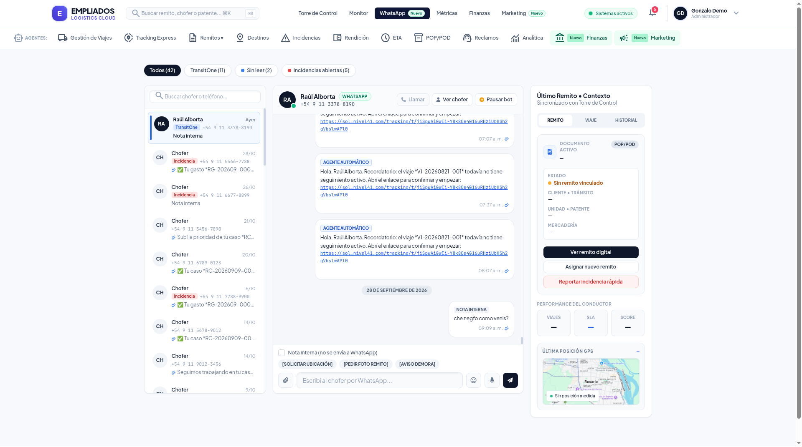
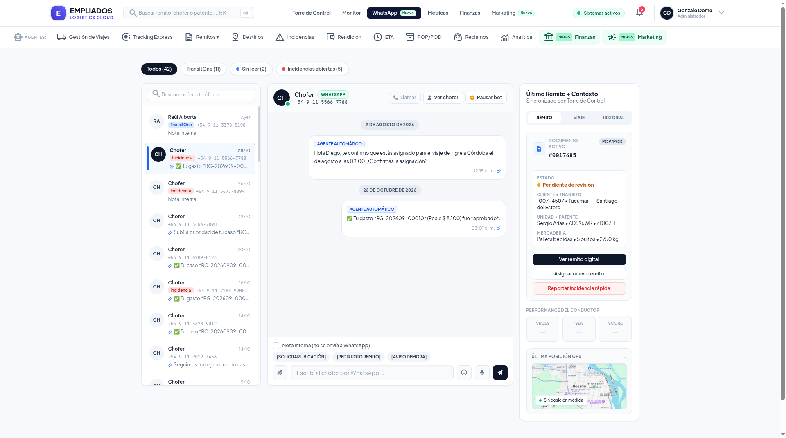

**Lo que funciona:**
- Tres paneles
- Filtros Todos (42) / Sin leer (2) / Incidencias abiertas (5)
- Respuestas rápidas

**Problemas críticos:**
- Contactos casi todos "Chofer", indistinguibles
- Asteriscos de markdown crudos en mensajes
- Error filtrado en un chat: "Cannot read properties of undefined (reading 'id')"
- Mensajes automáticos repetidos
- Panel de contexto con "—" en casi todo
- "Reportar incidencia rápida" en rojo como si fuera destructivo

**Recomendación concreta:**
Nombre + patente en cada fila; agrupar recordatorios automáticos; ocultar bloques sin datos; rojo solo para lo destructivo.

#### Métricas

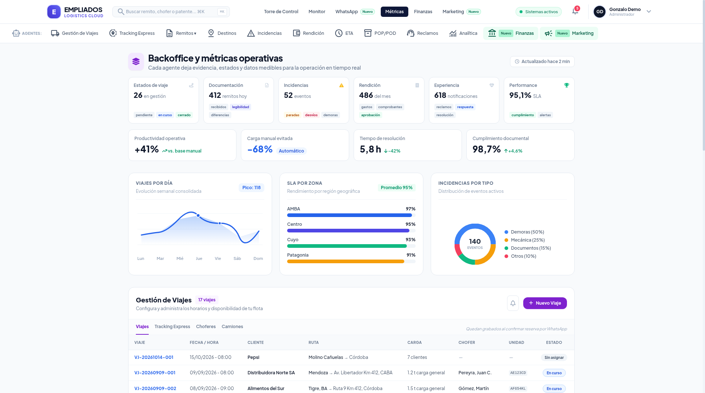
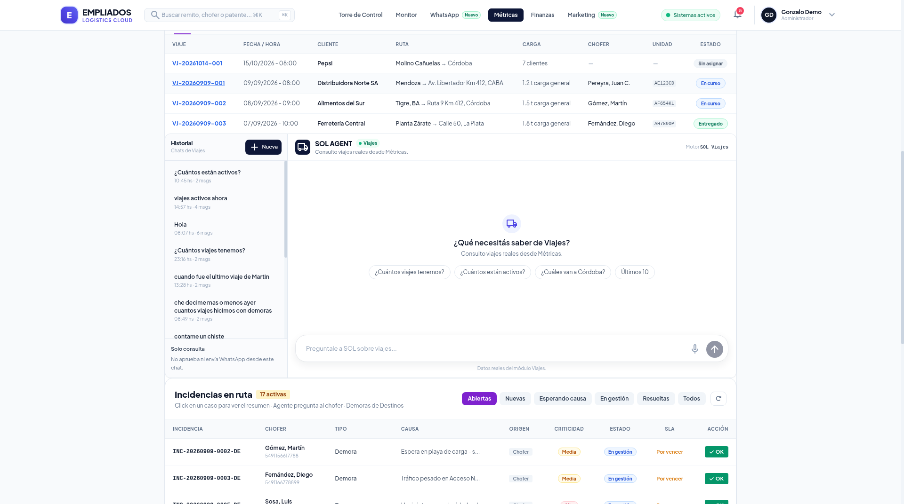
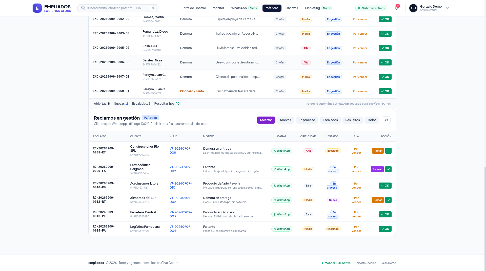

**Lo que funciona:**
- Fila de KPIs con chips
- SLA por zona en barras legibles (AMBA 97%, Centro 95%, Cuyo 93%, Patagonia 91%)

**Problemas críticos:**
- 12 KPIs sin jerarquía
- Donut "140 eventos" vs "52 eventos" en Incidencias
- Tabla Gestión de Viajes duplicada "17 viajes"

**Recomendación concreta:**
Máximo 4 KPIs norte; cada cifra con definición y fuente al hacer hover; sacar la tabla duplicada y enlazar a Viajes.

---

### Agentes

#### Gestión de Viajes


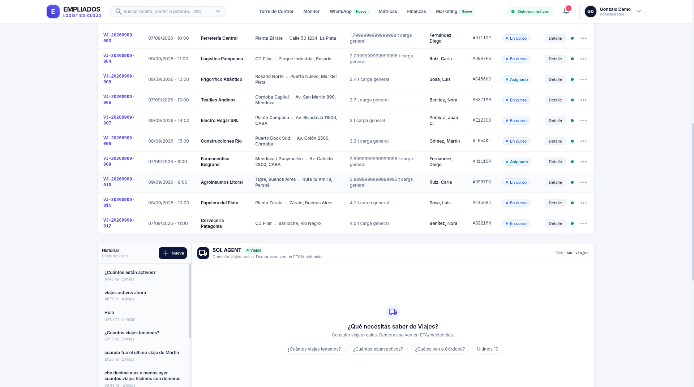
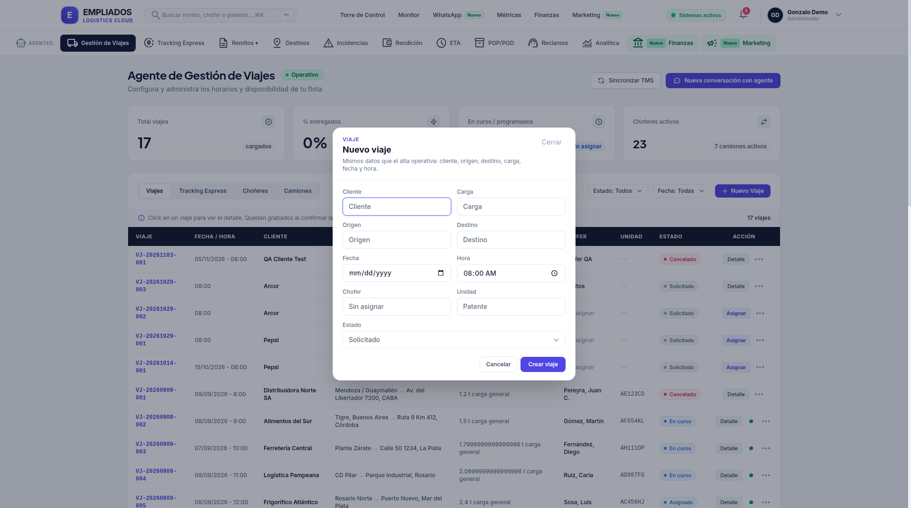
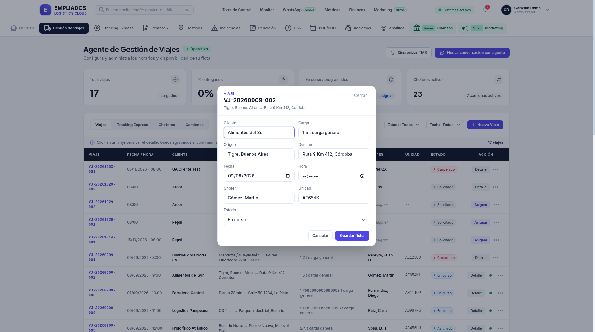

**Lo que funciona:**
- KPIs arriba
- Filtros Estado / Fecha
- Acción por fila (Detalle / Asignar)

**Problemas críticos:**
- Float "1.7999999999999998 t"
- IDs partidos en dos líneas
- Fechas sin año o sin hora
- Pestañas Choferes y Camiones no hacen nada
- Cancelado con "Asignar"
- "•••" abre edición
- El detalle es el mismo formulario de edición ("Guardar ficha") sin timeline ni mapa
- Nuevo viaje usa fecha "mm/dd/yyyy"
- "Nueva conversación con agente" lleva a /contactos (WhatsApp)

**Recomendación concreta:**
Cargas a 1 decimal; ID en una línea; detalle de solo lectura con timeline, mapa y remitos, y Editar aparte; fecha dd/mm/aaaa; el botón abre un chat con el agente o se renombra "Ir a WhatsApp".

#### Tracking Express


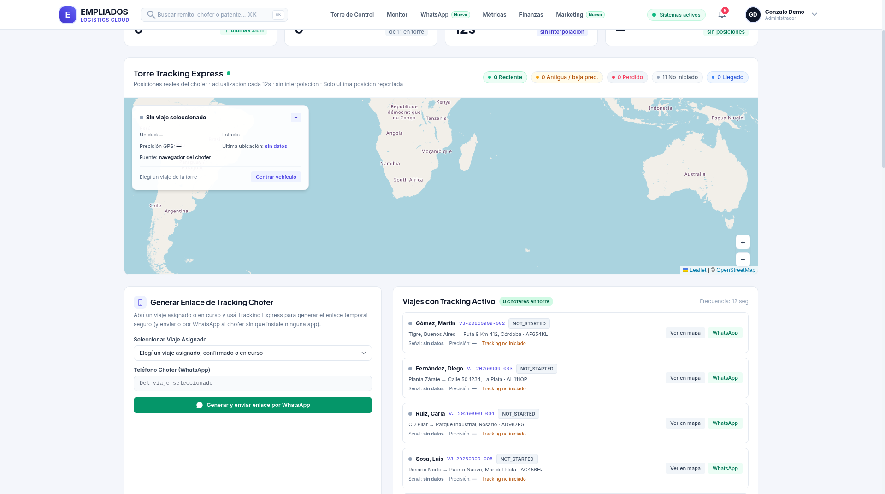

**Lo que funciona:**
- Flujo directo para generar un enlace de seguimiento

**Problemas críticos:**
- El mapa carga el MUNDO (África, Australia), no Argentina
- "Sin viaje seleccionado" y contadores en 0
- Chips "Fuente: Navegador", "Modo: abierto", "Segundo plano: No garantizado"
- "Viajes con Tracking Activo" todos NOT_STARTED "sin datos"
- Botón verde "Generar y enviar enlace por WhatsApp"
- Duplicado como pestaña dentro de Viajes

**Recomendación concreta:**
Mapa centrado en Argentina; preseleccionar el viaje más reciente; chips técnicos en un "Detalles" colapsable; "Sin iniciar" en vez de NOT_STARTED; una sola ubicación del módulo.

#### Remitos

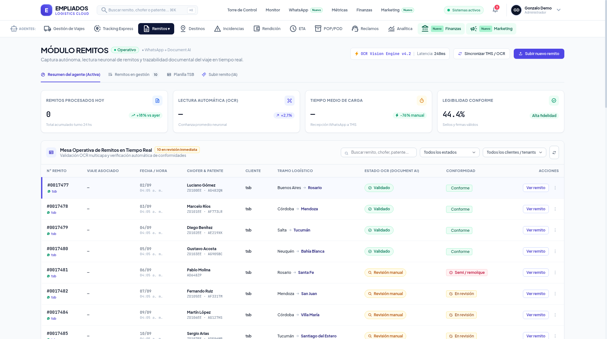
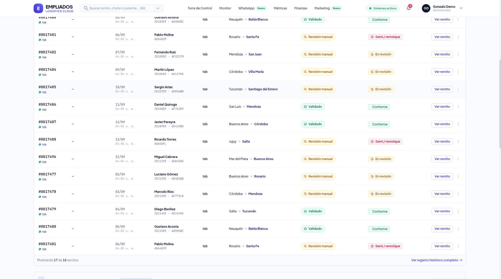

**Lo que funciona:**
- Fila seleccionada con borde violeta a la izquierda: buen feedback

**Problemas críticos:**
- Título "MÓDULO REMITOS" en caps
- Tag "OCR Vision Engine v4.2 | Latencia: 248ms"
- KPI "44.4% Legibilidad" rotulado "Alta fidelidad"
- Viaje asociado todo "—"
- Cliente todo "tsb"
- Todas las horas "04:05 a. m."
- "Mostrando 17 de 18" y "Mostrando 8 de 8" bajo una lista vacía
- #0017481 duplicado
- "Remitos procesados hoy 0, +18% vs ayer"
- "Remitos ▾" sin submenú

**Recomendación concreta:**
Rótulo de calidad derivado del valor (44,4% = Baja); vincular viaje o mostrar "Sin vincular" como acción; contador igual a las filas visibles; quitar el caret y la versión del motor.

#### Destinos

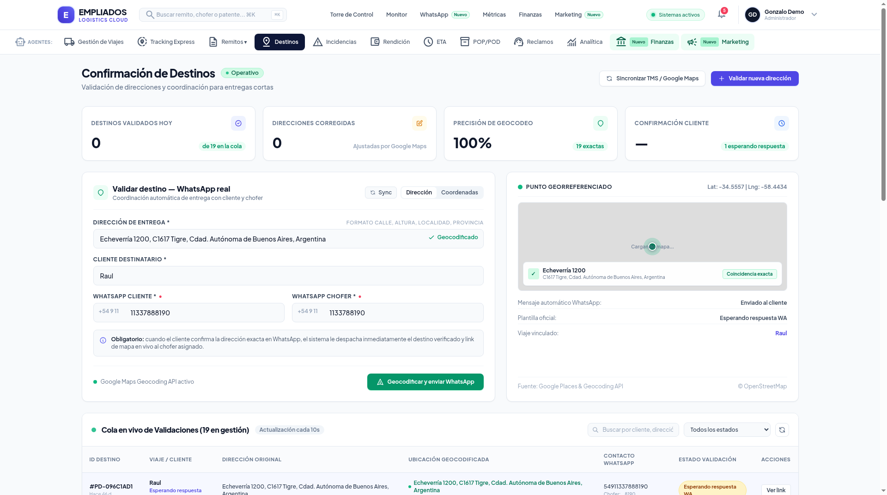

**Lo que funciona:**
- Validación de destino por WhatsApp como concepto

**Problemas críticos:**
- Formulario primero ("Validar destino — WhatsApp real")
- Mapa trabado en "Cargando mapa…"
- Datos tipo placeholder "Raul / Echeverría 1200 / 11337888190"
- Etiquetas caps diminutas
- Cola "19 en gestión" con paginación "Anterior 1 Siguiente"

**Recomendación concreta:**
La cola arriba y el formulario en un panel lateral al elegir una fila; timeout del mapa con reintento; ocultar paginación de una página.

#### Incidencias

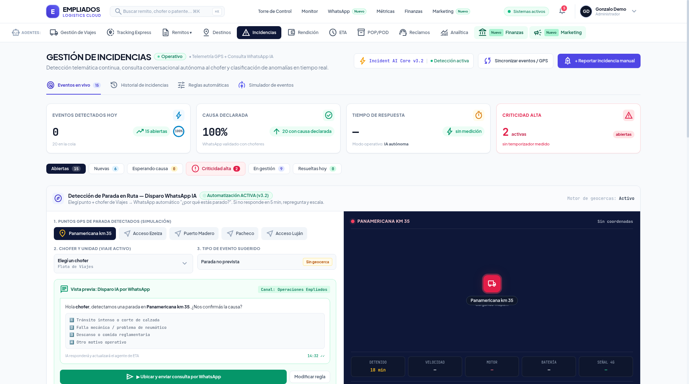
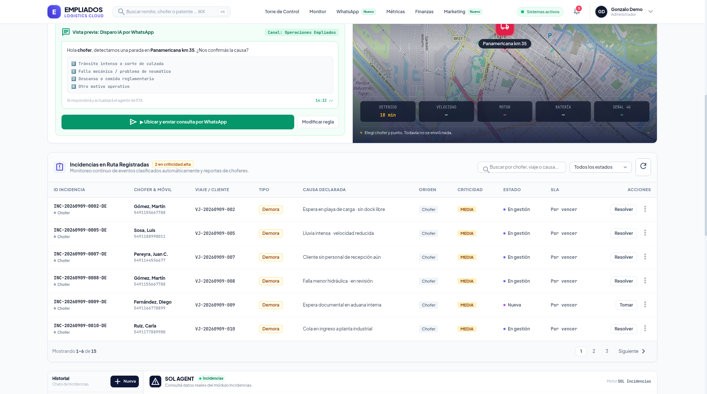

**Lo que funciona:**
- Pestañas Abiertas / Nuevas / Esperando causa / Criticidad alta
- Vista previa del WhatsApp que se enviará

**Problemas críticos:**
- "EVENTOS DETECTADOS HOY 0" con "15 abiertas"
- "CAUSA DECLARADA 100%"
- El simulador "Detección de Parada en Ruta" con panel de telemetría oscuro ocupa el espacio principal y deja la lista real bajo el pliegue
- Botón verde de envío real dentro del simulador

**Recomendación concreta:**
La lista de incidencias reales primero; el simulador en su pestaña; panel claro coherente; confirmación con destinatario; KPIs del mismo período.

#### Rendición

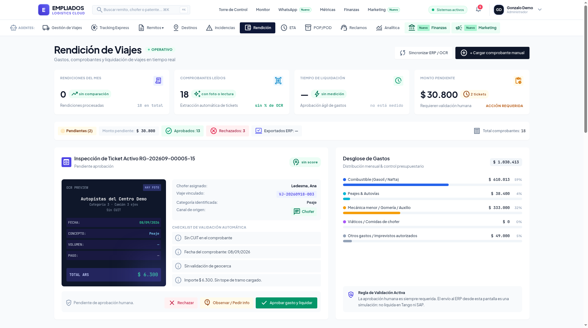


**Lo que funciona:**
- **La mejor pantalla:** inspección del ticket con vista OCR y jerarquía clara Rechazar (borde rojo) / Observar (ámbar) / "Aprobar gasto y liquidar" (verde)
- Barras de Desglose de Gastos

**Problemas críticos:**
- Acciones solo con ícono (ojo, check, x) sin etiqueta
- Montos "$ 30.800" vs "$30.800"

**Recomendación concreta:**
Usarla como plantilla de flujos de aprobación; etiquetas o tooltips en íconos; un formato de moneda.

#### ETA

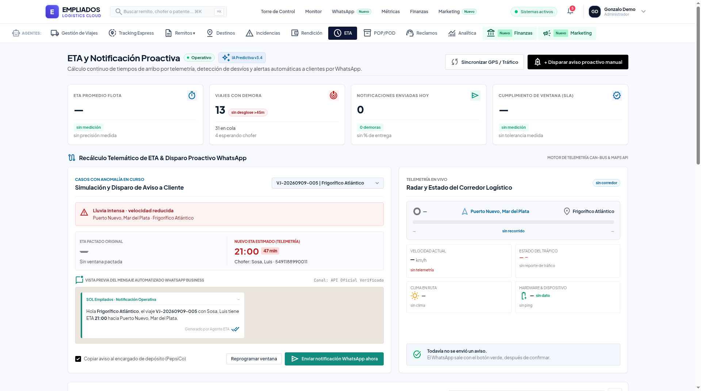

**Lo que funciona:**
- Vista previa del WhatsApp y anomalía en rojo "Lluvia intensa" fáciles de leer

**Problemas críticos:**
- KPIs casi todos "— sin medición"
- Panel de radar vacío
- snake_case "Demora · en_gestión"
- Primario negro

**Recomendación concreta:**
Ocultar KPIs sin dato o explicar desde cuándo se miden; "En gestión"; primario de marca.

#### POP/POD


**Lo que funciona:**
- Buen concepto de cadena de custodia
- CTA verde "Confirmar y Cerrar Viaje"

**Problemas críticos:**
- Placeholders de foto como cajas celestes vacías (parecen rotas)
- Mapa "Sin coordenadas"
- "PRECISIÓN DOCUMENT AI —"

**Recomendación concreta:**
Ícono y texto "Sin foto aún" en cada caja; ocultar el mapa sin coordenadas; bloquear el cierre si falta evidencia.

#### Reclamos

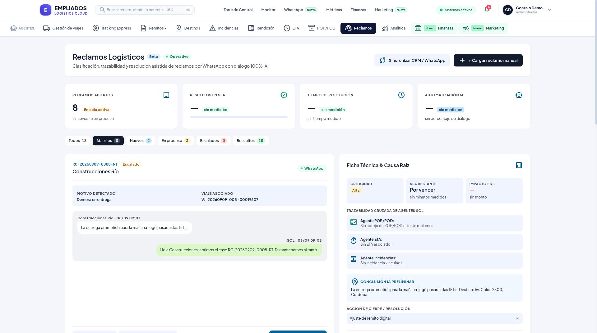

**Lo que funciona:**
- Buen maestro-detalle con trazabilidad entre agentes

**Problemas críticos:**
- Badge "Beta" y card de header blanca distinta al resto
- "Resueltos 18" igual a Todos 18 con 8 abiertos
- Gran hueco vacío en el chat
- "Resolver y notificar cliente" en teal, color que no aparece en ninguna otra pantalla

**Recomendación concreta:**
Conteos que sumen; header estándar; chat que se ajusta al contenido; primario de marca.

#### Analítica (agentes)


**Lo que funciona:**
- Cards de alerta con buen color semántico

**Problemas críticos:**
- Tooltip "Jue: 1.120 viajes / 96,2% a tiempo" vs "Total semana: 4 viajes"
- Eje Y 1.4k
- Nota "La curva del dibujo no es la serie medida." (admite un gráfico ilustrativo)
- Barras de SLA vacías
- Texto diminuto
- Inglés "KPI, BI / Looker, BigQuery, Streaming"

**Recomendación concreta:**
Graficar solo series medidas o marcar "Ilustrativo" de forma explícita; ocultar barras vacías; textos en español.

---

### Finanzas

#### Dashboard de Cobranzas

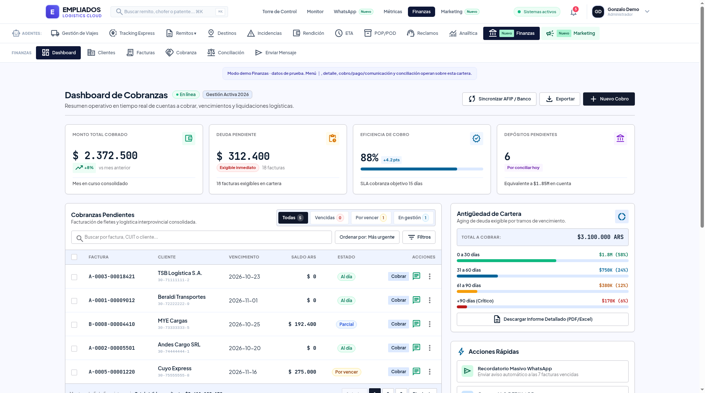


**Lo que funciona:**
- Antigüedad de cartera por tramos con color
- Banner de modo demo
- Filtros Todas / Vencidas / Por vencer / En gestión

**Problemas críticos:**
- Monto total $2.372.500 vs otros totales
- Facturas "Al día" con saldo $0 listadas como "Pendientes"
- Fechas ISO
- "Cobrar" en cada fila con peso igual a ver

**Recomendación concreta:**
Una sola fuente de verdad para cobrado y cartera; ocultar saldo 0 de pendientes; formato dd/mm/aaaa; Cobrar como acción secundaria con confirmación.

#### Clientes

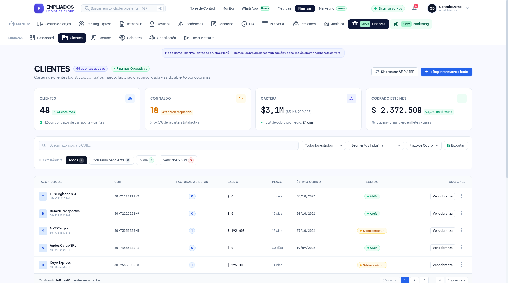

**Lo que funciona:**
- **La página mejor construida:** KPIs, filtros, avatares, CUIT, chips de estado

**Problemas críticos:**
- "Con saldo 18" vs filtro rápido "Con saldo pendiente 0"
- "+ Registrar nuevo cliente" en azul, no en el violeta de marca
- Ícono vacío en "COBRADO ESTE MES"

**Recomendación concreta:**
Un mismo cálculo para ambos conteos; primario de marca; quitar el ícono vacío.

#### Facturas a pagar


**Lo que funciona:**
- Ingreso por OCR disponible

**Problemas críticos:**
- Título en caps
- Dropzone de OCR de unos 160 px antes de los datos
- "Factura a pagar" repetido en cada fila
- "Mostrando 1–6 de 82" vs chips con 8 en total
- "Pagar / Autorizar" en negro igual que otros primarios, sin distinguir acciones irreversibles

**Recomendación concreta:**
Dropzone compacta o en modal; quitar el texto repetido; conteos coherentes; estilo dedicado de dinero con confirmación que muestra monto y beneficiario.

#### Cobranza

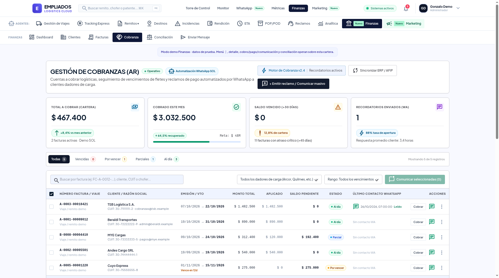

**Lo que funciona:**
- Acciones rápidas agrupadas

**Problemas críticos:**
- Header pesado "GESTIÓN DE COBRANZAS (AR)" + "Motor de Cobranza v2.4"
- "TOTAL A COBRAR $467.400", "Cobrado este mes $3.032.500 (Meta: $48M)", "SALDO VENCIDO $0" junto a "11 facturas con atraso crítico"
- Tres nombres (Cobranza / Gestión de Cobranzas / Dashboard de Cobranzas)

**Recomendación concreta:**
Un nombre por pantalla igual al de la nav; header estándar; saldo vencido calculado de las mismas facturas.

#### Enviar Mensaje

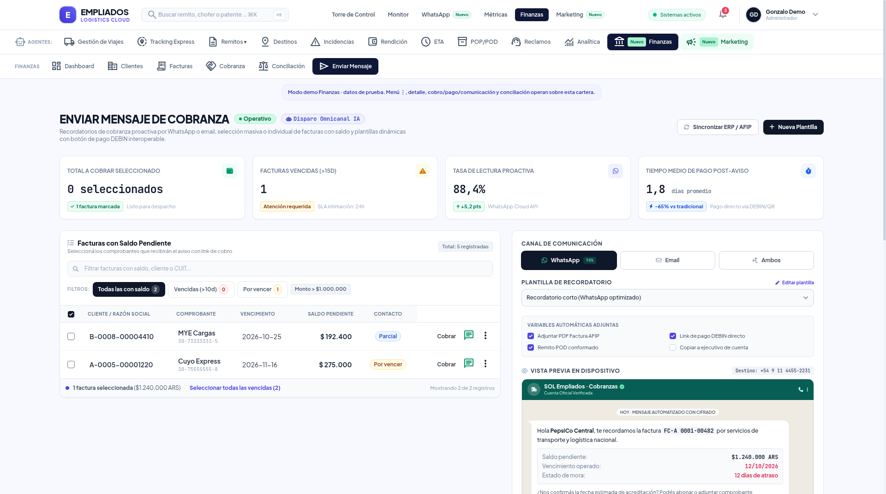
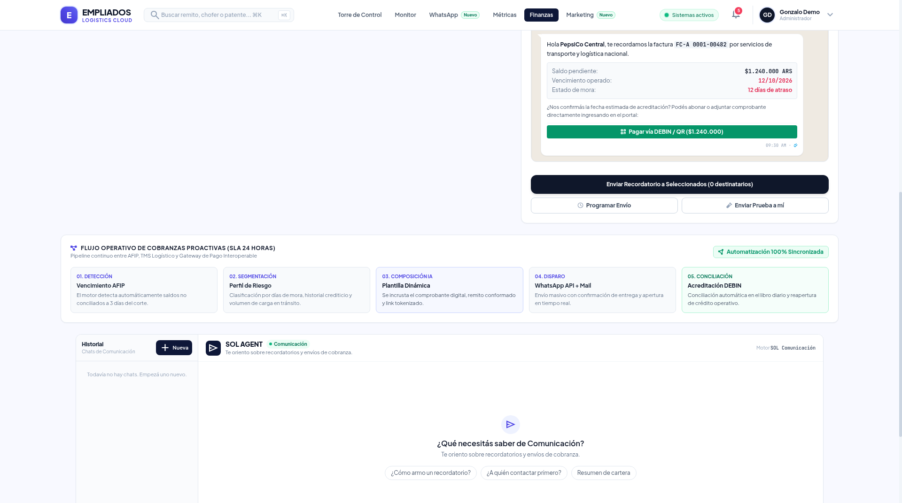

**Lo que funciona:**
- Buen explicador del flujo en 5 pasos

**Problemas críticos:**
- La vista previa de WhatsApp muestra "PepsiCo Central, FC-A 0001-00482, $1.240.000" y no las facturas elegidas (MYE Cargas, Cuyo Express)
- "0 seleccionados" vs "1 factura marcada"
- Ofrece Email aunque Marketing dice que está deshabilitado
- "Recordatorio Masivo WhatsApp" sin confirmación visible

**Recomendación concreta:**
Vista previa generada de la selección real; un solo contador; deshabilitar Email con motivo; paso de revisión de destinatarios y texto.

#### Conciliación


**Lo que funciona:**
- KPIs claros
- Acción "Conciliar" solo en la fila pendiente

**Problemas críticos:**
- "Todos (3)" vs 142 operaciones y 15 páginas
- IDs técnicos "demo-FAC-SYS-0002-1793404697156"
- "Hora Operativa: 15:42 ART" desfasada
- SOL vacío al pie

**Recomendación concreta:**
Paginación real; ID legible; reloj sincronizado o quitarlo.

---

### Marketing

#### Hub de Marketing

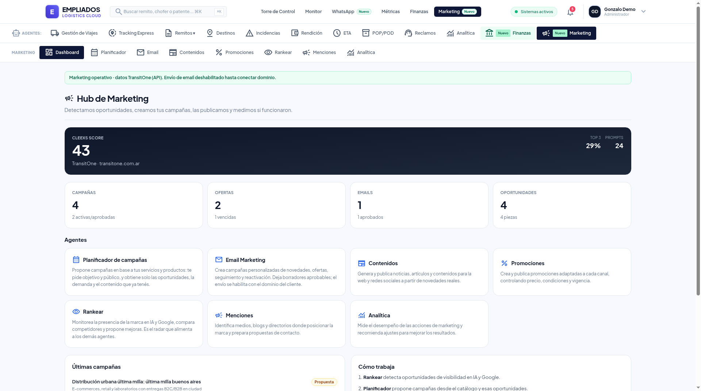

**Lo que funciona:**
- Explica el flujo ("Cómo trabaja": Rankear → Planificador…)
- Cards de agentes descriptivas

**Problemas críticos:**
- Banner navy de Cleexs Score rompe el dialecto
- KPIs sin contexto ("1 aprobados")

**Recomendación concreta:**
Score en card estándar con tendencia; plurales correctos.

#### Planificador

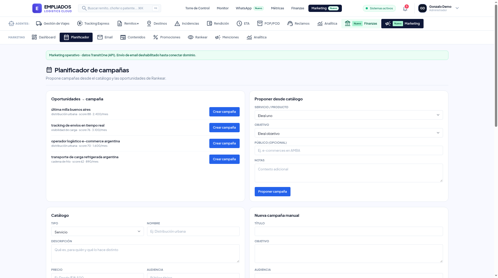
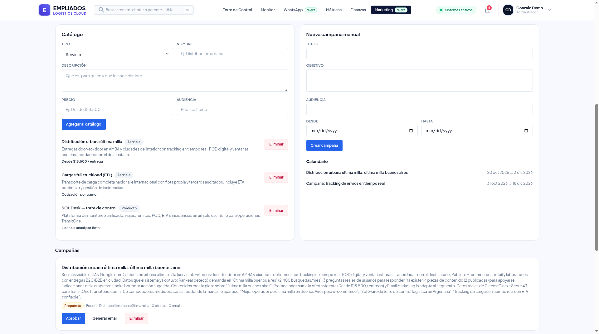

**Lo que funciona:**
- Oportunidades → campaña con score y volumen

**Problemas críticos:**
- Formularios largos en dos columnas sin pasos
- Catálogo guarda ítems sin nombre
- Eliminar da 400

**Recomendación concreta:**
Wizard en 3 pasos; validación cliente y servidor; arreglar DELETE.

#### Email

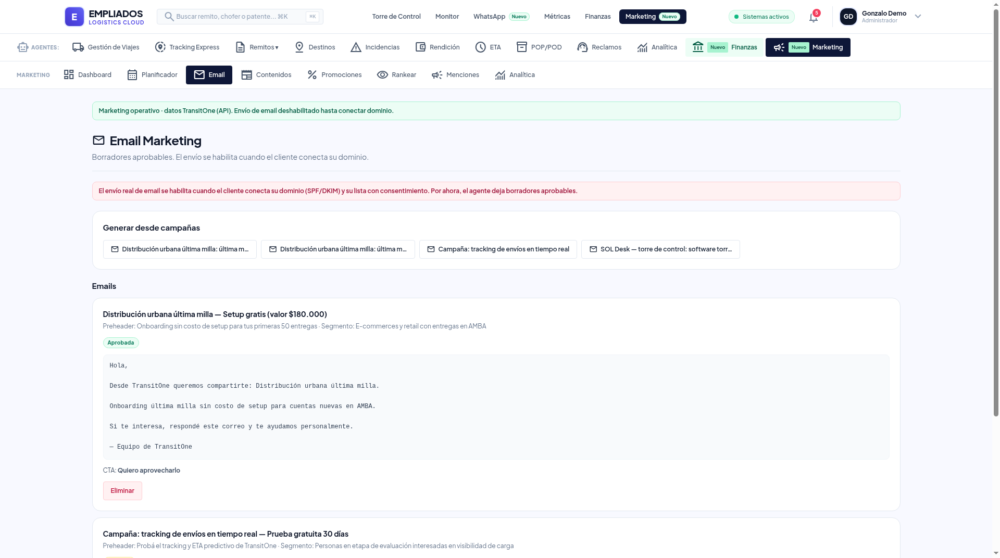

**Lo que funciona:**
- Avisa que el envío está deshabilitado

**Problemas críticos:**
- Dos banners (verde y rojo con jerga SPF/DKIM)
- Cuerpo en bloque monoespaciado
- Sin vista renderizada ni campos de asunto o destinatario
- Chips de campañas truncados y duplicados
- APPROVED, DRAFT

**Recomendación concreta:**
Un banner con lenguaje simple y link de ayuda; editor con asunto, destinatarios y vista previa real.

#### Contenidos

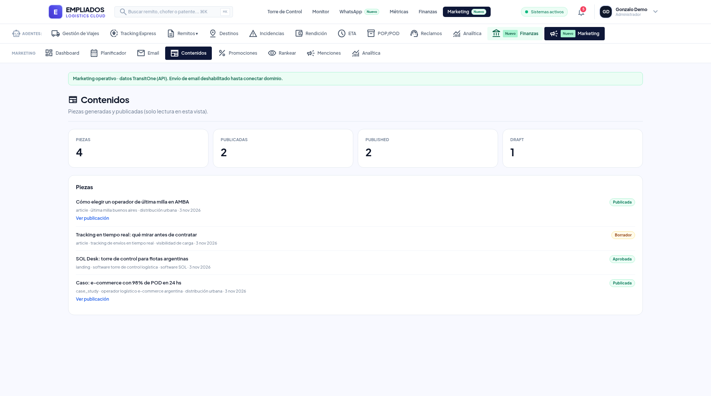

**Lo que funciona:**
- Separa piezas por tipo

**Problemas críticos:**
- "PIEZAS 4, PUBLICADAS 2, PUBLISHED 2, DRAFT 1" duplicado y sin traducir
- Tipos "article, landing, case_study"
- Más de media pantalla en blanco

**Recomendación concreta:**
Contadores únicos en español (Artículo, Landing, Caso de éxito); grilla que llena el espacio.

#### Promociones

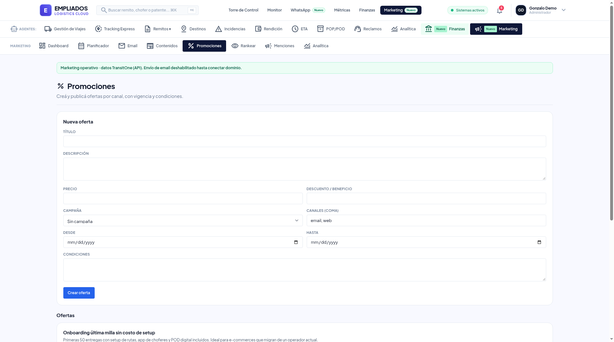

**Lo que funciona:**
- Creación con toast de éxito

**Problemas críticos:**
- Formulario vacío "Nueva oferta" arriba y la lista bajo el pliegue
- "CANALES (COMA)" como texto separado por comas
- Fecha mm/dd/yyyy
- Precio "abc" aceptado
- Título de 300 caracteres rompe el layout
- Borrar falla

**Recomendación concreta:**
Lista primero y "+ Nueva oferta" en modal; selector múltiple de canales; dd/mm/aaaa; campo moneda numérico.

#### Rankear

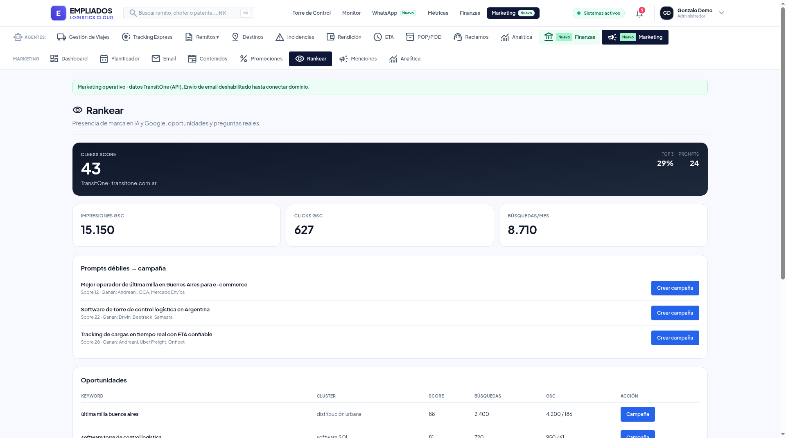
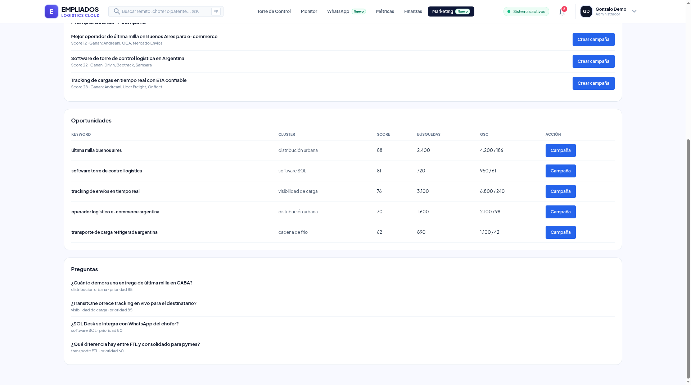

**Lo que funciona:**
- Concepto claro de radar de visibilidad

**Problemas críticos:**
- Jerga sin explicar (GSC, Cleexs, prompts, cluster)
- "GSC 4.200 / 186" críptico
- Sin ordenar
- Botones "Crear campaña" / "Campaña" repetidos

**Recomendación concreta:**
Glosario en tooltips; columnas rotuladas (Impresiones / Clics); orden por score; una acción por fila.

#### Menciones

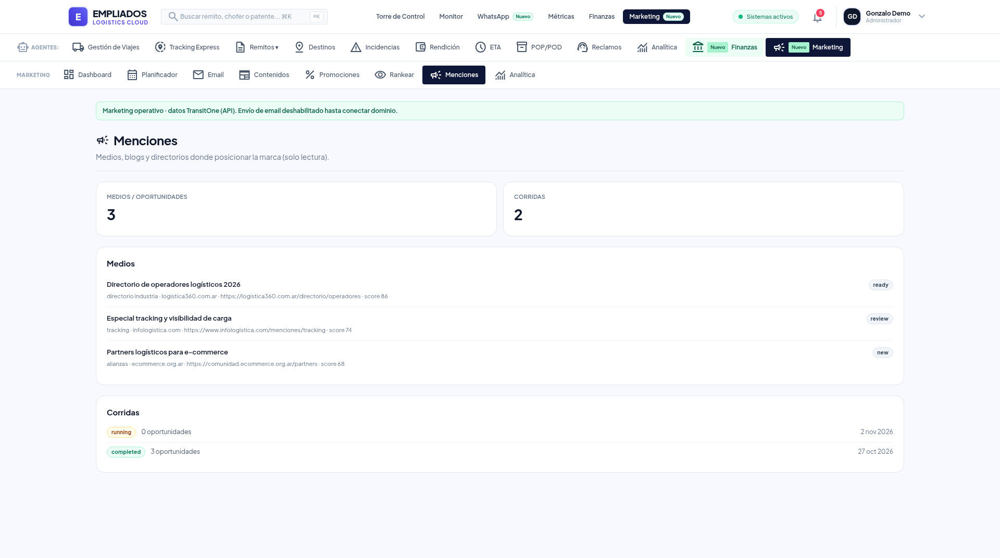

**Lo que funciona:**
- Lista de medios y directorios

**Problemas críticos:**
- Estados en inglés y minúscula (ready, review, new, running, completed)
- Callejón sin salida de solo lectura

**Recomendación concreta:**
Estados en español y una acción siguiente ("Preparar propuesta").

#### Analítica (marketing)

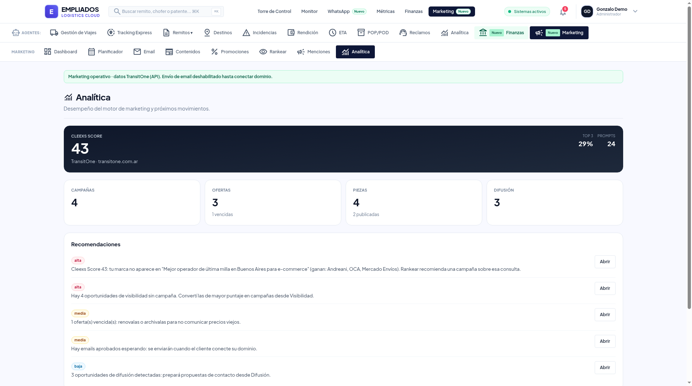

**Lo que funciona:**
- Ubicación lógica al final del flujo

**Problemas críticos:**
- Sin gráficos pese al nombre
- Destinos de "Abrir" poco claros
- Tercer "Analítica" del producto

**Recomendación concreta:**
Renombrar a "Resultados de marketing" con tendencias; botones que digan a dónde llevan.

---

## Propuesta de sistema de diseño

### Tokens

| Token | Propuesta |
|-------|-----------|
| **Primario** | Un solo color (sugerido: el violeta de marca). Negro, azul, verde y rojo dejan de ser primarios. |
| **Semánticos** | Éxito verde, Advertencia ámbar, Error rojo, Info azul, Neutro gris. Rojo solo para error y destructivo. |
| **Tipografía** | Mínimo 12 px en etiquetas y 13–14 px en tablas; escala 12 / 14 / 16 / 20 / 28. Sentence case, MAYÚSCULAS solo en overlines cortas. |
| **Cifras** | tabular-nums en sans; mono solo para IDs técnicos. |
| **Espaciado** | Escala de 4: 4 / 8 / 12 / 16 / 24 / 32. |
| **Formatos** | Fecha dd/mm/aaaa, hora 24 h, moneda $1.234.567, decimales con coma, 1 decimal en toneladas. |

### Componentes a unificar

| Componente | Regla |
|------------|-------|
| **KPI card** | Etiqueta, valor, comparación con período explícito, fuente en tooltip; nunca "—" sin motivo |
| **Page header** | Título en sentence case, subtítulo de una línea, estado, máximo 1 primario + 2 secundarios |
| **Tabla** | ID mono en una línea, montos a la derecha, estado en columna fija, acciones en menú etiquetado |
| **Status pill** | Un diccionario, un color por significado, ícono además del color |
| **Filter chips** | Conteo coherente con la tabla debajo |
| **Botones** | Primario / Secundario / Terciario / Destructivo / Dinero-envío (con confirmación que muestra monto o destinatarios) |

### Navegación propuesta

**Una sola barra lateral colapsable** con cinco grupos, un único estado activo y búsqueda global arriba. Se elimina la fila AGENTES y la duplicación de Finanzas y Marketing.

```
Sidebar
├── Operación
│   ├── Torre de Control
│   ├── Viajes
│   ├── Tracking
│   ├── Incidencias
│   └── WhatsApp
├── Documentación
│   ├── Remitos
│   ├── POD
│   ├── Rendición
│   └── Reclamos
├── Finanzas
│   ├── Cobranzas
│   ├── Facturas
│   └── Conciliación
├── Marketing
│   ├── Hub
│   ├── Campañas
│   └── Rankear
└── Sistema
    ├── Monitor
    ├── Métricas
    └── Agentes
```

### Diccionario de estados

| Hoy en la app | Propuesto | Tono |
|---------------|-----------|------|
| Solicitado / Sin asignar | Sin asignar | Advertencia |
| Asignado | Asignado | Info |
| En curso | En viaje | Info |
| Cancelado | Cancelado | Neutro |
| Al día / Parcial / Por vencer | Al día / Pago parcial / Por vencer / Vencida | Éxito / Advertencia / Advertencia / Error |
| APPROVED / DRAFT | Aprobado / Borrador | Éxito / Neutro |
| Offline / En hold / En espera | Desconectado / En pausa / Esperando | Error / Advertencia / Neutro |

---

## Recomendaciones por perfil

### 👤 Despachante: Torre por excepción

Cola priorizada de lo que requiere acción ahora (sin asignar, demorados, paradas no previstas), acciones en un clic con confirmación, WhatsApp con nombre y patente, atajos de teclado.

### 💰 Finanzas: Números conciliables

Un único total de cobrado y cartera, drill-down de cada KPI hasta la factura, confirmación con monto en Cobrar / Conciliar / Recordatorio masivo, exportación con el mismo filtro visible.

### 📊 Dirección: Fuente única de verdad

Un tablero de 4–6 KPIs norte con definición, período y tendencia, vista mobile real y estado del sistema honesto en el header.

---

## Roadmap priorizado

### Quick wins (Alto impacto, Bajo esfuerzo)

| Acción | Impacto | Esfuerzo |
|--------|---------|----------|
| Redondear cargas y montos; fecha local sin corrimiento de zona horaria | Alto | Bajo |
| Header "Sistemas activos" leído de Monitor | Alto | Bajo |
| Arreglar DELETE 400 y validar precio y nombre | Alto | Bajo |
| Traducir enums y quitar badges "Nuevo" | Medio | Bajo |
| Confirmación en Cobrar, Conciliar y envíos de WhatsApp | Alto | Bajo |

### Mediano plazo (1–2 meses)

| Acción | Impacto | Esfuerzo |
|--------|---------|----------|
| Tokens: un primario, escala tipográfica, sentence case | Alto | Medio |
| Componentes únicos de KPI, tabla, pill y header | Alto | Medio |
| Sidebar agrupada y deep links por viaje y factura | Alto | Medio |

### Estructural (trimestre)

| Acción | Impacto | Esfuerzo |
|--------|---------|----------|
| Capa de métricas única con definiciones compartidas | Muy alto | Alto |
| Torre de Control por excepción y SOL como panel lateral | Muy alto | Alto |
| Responsive real y salir del esquema de iframes | Alto | Alto |

---

## Referencias de capturas

Ver carpeta `screenshots/ux-transitone/` para todas las capturas organizadas por módulo:
- `01-login-*.png` — Login
- `02-torre-control*.png` — Torre de Control
- `03-monitor*.png` — Monitor de Servicios
- `04-whatsapp*.png` — WhatsApp
- `05-metricas*.png` — Métricas
- `06-viajes*.png` — Gestión de Viajes
- `08-tracking*.png` — Tracking Express
- `09-remitos*.png` — Remitos
- `10-destinos.png` — Destinos
- `11-incidencias*.png` — Incidencias
- `12-rendicion*.png` — Rendición
- `13-eta.png` — ETA
- `14-pop-pod.png` — POP/POD
- `15-reclamos.png` — Reclamos
- `16-analitica-agentes.png` — Analítica (Agentes)
- `20-finanzas-dashboard*.png` — Dashboard de Cobranzas
- `21-finanzas-clientes.png` — Clientes
- `22-finanzas-facturas-a-pagar.png` — Facturas a pagar
- `23-finanzas-cobranza.png` — Cobranza
- `24-finanzas-conciliacion.png` — Conciliación
- `25-finanzas-enviar-mensaje*.png` — Enviar Mensaje
- `30-marketing-dashboard.png` — Hub de Marketing
- `31-marketing-planificador*.png` — Planificador
- `32-marketing-email.png` — Email
- `33-marketing-contenidos.png` — Contenidos
- `34-marketing-promociones.png` — Promociones
- `35-marketing-rankear*.png` — Rankear
- `36-marketing-menciones.png` — Menciones
- `37-marketing-analitica.png` — Analítica (Marketing)
- `40-hover-*.png` — Interacciones
- `50-narrow-*.webp` — Responsive / Zoom
- `51-narrow-torre-300pct.png` — Torre al 300%
